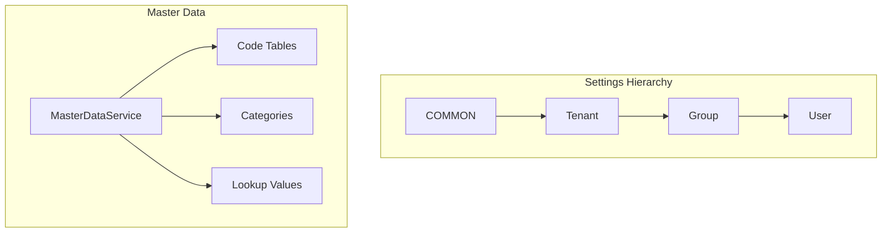

# Master


The Master Service provides functionality for managing master data and settings in a multi-tenant environment.
## Overview {#overview}

The Master Service consists of two main components:


### Master Setting Service
- Implements hierarchical settings management
- Supports creation of settings at all levels
- Provides update and delete operations for tenant settings
- Implements cascading settings retrieval


### Master Data Service
- Implements CRUD operations for master data entities
- Provides list and retrieval functionality
- Includes code validation capabilities
- Ensures data integrity across tenant boundaries

## Architecture {#architecture}



## Settings Hierarchy Levels {#settings-hierarchy}

The Master Setting Service implements a four-level hierarchy. Settings cascade from the most specific level toward the most general — `getSetting` returns the first match found:

| Level | Scope | Created with | Use case |
|-----------|-----------|-----------------|-------------|
| **Common** | System-wide default | `createCommonTenantSetting` | Baseline values shared by all tenants |
| **Tenant** | Single tenant | `createTenantSetting` | Tenant-specific overrides of common defaults |
| **Group** | Tenant group | `createGroupSetting` | Group-level overrides within a tenant |
| **User** | Individual user | `createUserSetting` | Personal preferences within a tenant |

`getSetting` resolves a setting code in this order: **User → Group → Tenant → Common**. If no setting exists at any level, a `NotFoundException` is thrown.

## Installation {#installation}

```bash
npm install @mbc-cqrs-serverless/master
```

## Basic Usage {#basic-usage}

The solution for customizing the behavior of the `MasterModule` is to pass it an options `object` in the static `register()` method.

### Module Options {#module-options}

| Option | Type | Description |
|--------|------|-------------|
| `enableController` | `boolean` | Enable or disable default master controller |
| `dataSyncHandlers` | `Type<IDataSyncHandler>[]` | Optional handlers to sync master data to external systems (e.g., RDS) |
| `prismaService` | `Type<any>` | Prisma service for RDS-backed queries. Required when `enableController: true` |
| `tableName` | `string` | DynamoDB base table name (default: `master`) |
| `commonTenantCode` | `string` | Tenant that holds the common master data (default: `common`) |
| `controllerAuth` | `{ read?: string[]; write?: string[] }` | Opt-in guard for the built-in routes. See [Controller Authorization](#controller-auth) |
| `enableCopyTask` | `boolean` | Register the master copy handler (default: the value of `enableController`) |
| `databaseProvider` | `'postgresql' \| 'mysql'` | Database the Prisma client talks to (default: detected from the Prisma client). See [Database Provider](#database-provider) |

:::warning prismaService Requirement
When `enableController: true`, the `prismaService` parameter is **required**. The module will throw an error at startup if `prismaService` is not provided when the controller is enabled.
:::

```ts
import { MasterModule } from '@mbc-cqrs-serverless/master'

@Module({
  imports: [ MasterModule.register({
      enableController: true,
      dataSyncHandlers: [MasterDataRdsSyncHandler],
      prismaService: PrismaService,
      controllerAuth: {}, // Require a login for reads and system_admin for writes
    })],
  controllers: [],
  exports: [],
})

```

## Key Rules {#key-rules}

Master keys are built from the codes in a request: a setting is stored under `MASTER_SETTING#<code>`, a data row under `<settingCode>#<code>`, and group and user settings under `MASTER_SETTING#GROUP#<groupId>#<code>` and `MASTER_SETTING#USER#<userId>#<code>`. Each of these values must be a single key segment:

- It must not be empty.
- It must not contain `#`, the key separator. Otherwise the value builds the key of another row; for example the setting code `USER#u1#S1` is a user's personal setting.
- It must not contain `@`, the version separator of a sort key.
- A setting code, and the `settingCode` of master data, must not be `MASTER_SETTING`.

A request that breaks a rule fails with 400. The rule applies to every setting create and upsert (common, tenant, group, user and bulk), to master data create, upsert and both bulk endpoints, to `getSetting` (`GET /api/master-setting/:code`) and to `MasterDataService.list` (`GET /api/master-data`). Bulk requests validate the keys of every item before the first write.

Rows are changed only through their own routes. `PATCH`/`DELETE /api/master-setting/:pk/:sk` (`updateSetting`/`deleteSetting`) accept only setting keys (`MASTER_SETTING#<code>`, plus group and user keys), and `PUT`/`DELETE /api/master-data/:pk/:sk` (`update`/`delete`) reject `MASTER_SETTING#...` keys. Both reject a sort key that contains `@`.

:::warning Known Issue (Fixed in v1.8.0)
In versions prior to v1.8.0, codes were not validated. Core cut a sort key at its last `@`, so a value with one `@`, such as an e-mail address used as a `userId` or code, was silently stored under a truncated, different key, and a code with two or more `@` (for example `X@Y@Z`) could store a row whose key still contains `@` (`MASTER_SETTING#X@Y`). Since v1.8.0 such rows can no longer be read, updated or deleted through the API: find them (a sort key containing `@` in the DynamoDB data table or the RDS master table) and re-create them under a valid key. Master data rows already stored with `#` in their `code` stay readable and can still be updated or deleted by key.

See also: [Migration Guide v1.8.0](/docs/migration/v1.8.0#key-segments)
:::

## Controller Authorization {#controller-auth}

Set `controllerAuth` to protect the built-in master routes. Setting it, even as an empty object, turns on `MasterControllerGuard` on `MasterDataController`, `MasterSettingController`, `MasterBulkController`, `MasterAccessController` and the task controller (`/api/tasks`).

```ts
MasterModule.register({
  enableController: true,
  controllerAuth: { read: [], write: ['master_editor'] },
  dataSyncHandlers: [MasterDataSyncRdsHandler],
  prismaService: PrismaService,
})
```

- A request without a `sub` claim is rejected.
- `read` empty or omitted means any logged-in user. `write` empty or omitted falls back to `system_admin` only. `system_admin` always passes, and roles resolved from groups count.
- `GET` routes and the two `POST .../check-exist` routes are reads. Every other route is a write.
- The tenant named in the request (path key, `tenantCode` in the body or query, the copy source and targets) must be the caller's tenant, unless the request only reads the common tenant or the caller has a cross-tenant role. Otherwise the guard answers 400 `Invalid tenant code`.
- `POST /api/master-setting/copy` requires `system_admin` whatever `write` says (see [Master Copy Access](#master-copy-access)).
- Without `controllerAuth`, the routes stay unguarded and `MasterModule` logs a startup warning when the controllers are enabled.

:::info Version Note
`controllerAuth`, `commonTenantCode`, `enableCopyTask`, `databaseProvider`, `systemId`, `@MasterAccessResolver()`, `GET /api/master-access`, `assignSystem` and `includeCommon` were added in [version 1.8.0](/docs/changelog#v180). Projects created with `mbc new` from v1.8.0 get an empty `controllerAuth` object, so master writes need `system_admin` until you configure roles.
:::

:::caution Common tenant selected by header
A caller whose token has no `custom:tenant` claim and who names the common tenant in `x-tenant-code` may get 403 when `commonTenantCode` is not listed in the `COMMON_TENANT_CODES` environment variable, because the tenant-override check of the base `RolesGuard` reads that variable rather than the module option. If you change `commonTenantCode`, add the same value to `COMMON_TENANT_CODES`.
:::

## Access Control per System {#access-control}

Several products can share master data maintained in one central service. Each master setting can carry a `systemId` that says which product the setting and its data are for, and an optional access resolver grants read and write per system and per setting. Without a resolver, `systemId` is ignored and the services behave as before.

For the full design, the rollout order and publishing changes to SNS per system, see the framework guide [Master data access control and per-system sync](https://github.com/mbc-net/mbc-cqrs-serverless/blob/main/docs/development/master-access-and-sync.md).

### System ID {#system-id}

- `systemId` is stored in `attributes.__systemId` (constant `MASTER_SYSTEM_ATTRIBUTE`, reader `getSystemId(row)`), outside the key, so each setting code has one owner within a tenant. API responses return it as a top-level `systemId` and hide `__systemId` from `attributes`.
- A `__systemId` sent by a client in `attributes` is always removed, with or without a resolver.
- `shared` is reserved for data every system receives. A row without a `systemId` counts as `shared`.
- A new setting may carry `systemId` in `CommonSettingDto`, `TenantSettingDto` or a bulk setting item. A setting with the same code as one visible through the tenant-then-common lookup inherits its `systemId`, and a conflicting explicit value is a 400. A tenant-level override of a common setting that has no `systemId` is treated as `shared`.
- A data row never accepts `systemId` from the client. It takes the value of its effective setting (the tenant's, then the common tenant's).
- `systemId` is stored in lower case, cannot be `*`, and cannot be changed once set.
- Group and user settings never store `systemId`; access follows their base setting.

### Writing a Resolver {#access-resolver}

Register exactly one class with `@MasterAccessResolver()`. The decorator applies `@Injectable()`, so do not add it yourself. Add the class to the providers of a module that is loaded with `MasterModule`. More than one resolver throws at startup.

```ts
import {
  IMasterAccessResolver,
  MasterAccessGrant,
  MasterAccessResolver,
  ResolveMasterAccessInput,
} from '@mbc-cqrs-serverless/master'

@MasterAccessResolver()
export class AppMasterAccessResolver implements IMasterAccessResolver {
  async resolveGrants(
    input: ResolveMasterAccessInput, // userId, tenantCode, roles, claims
  ): Promise<MasterAccessGrant[]> {
    if (!input.userId) return []
    if (input.roles.includes('system_admin')) {
      return [{ systemId: '*', settingCode: '*', read: true, write: true }]
    }
    const grants: MasterAccessGrant[] = [
      // Everyone may read shared data
      { systemId: 'shared', settingCode: '*', read: true, write: false },
    ]
    if (input.roles.includes('app_a_editor')) {
      grants.push({ systemId: 'app-a', settingCode: '*', read: true, write: true })
    }
    return grants
  }
}
```

- A grant has `systemId` (or `*`), `settingCode` (or `*`), `read` and `write`. Write implies read.
- With a resolver registered, access is denied by default and grants are a union. If the resolver throws, the request fails.
- There is no built-in bypass for `system_admin`: the resolver decides, usually by returning `*` grants.
- Grants are resolved once per request event.

### What the Services Check {#service-checks}

`MasterSettingService` and `MasterDataService` enforce access themselves, so your own routes are checked too. The methods take an options object with `invokeContext` and these optional fields:

```ts
interface MasterAccessOptions {
  invokeContext?: IInvoke
  scope?: { tenantCode?: string; systemId?: string } // Narrows only
  skipAccessCheck?: boolean // Trusted internal work
  systemId?: string // Internal callers only, used by copy
}
```

With a resolver registered:

1. `skipAccessCheck: true` passes.
2. A call without `invokeContext` is denied with 403, including reads. Server-side code must pass `invokeContext`, or `skipAccessCheck: true` for trusted internal work.
3. The record's tenant must be the caller's tenant, a common tenant for a read, or the caller must hold a cross-tenant role.
4. A caller who is not logged in cannot write, and needs `scope.tenantCode` to read.
5. The grants must cover the record's `systemId` (or `shared`) and setting code.

List endpoints add the grants to the Prisma `where`, so pagination and `total` stay correct; no grants means an empty list. A `systemId` in the search only narrows the result. `checkExistCode` checks only the tenant, so a form can warn about a code owned by a system the user cannot see.

### Access Endpoint {#master-access-endpoint}

`GET /api/master-access` returns `enabled` and `grants`, so a UI can show or hide actions. Without a resolver, `enabled` is false and `grants` is empty. For a caller who is not logged in, `enabled` is true, `grants` is empty and the resolver is not called. Applications with their own routes can call `MasterAccessService.getAccess` with `invokeContext`.

### Tagging Existing Data {#assign-system}

`MasterSettingService.assignSystem` gives the existing untagged rows of a setting code an owning system:

```ts
const { updated } = await this.masterSettingService.assignSystem(
  { code: 'APP_A_ROUTE_TYPE', systemId: 'app-a', tenantCode: 'acme' },
  { invokeContext },
)
```

- It requires a resolver, and write access on the target system and on `shared`. Without `tenantCode` it covers every tenant and needs a cross-tenant role.
- It finds candidate rows in RDS (`system_id` is `NULL`), skips a row whose latest command already has a `systemId`, and returns the number of rows it published. Group and user settings are left alone.
- It is a migration tool without a built-in route. Run it before consumers subscribe, and split the work per tenant to stay within the Lambda timeout.

### Include Common Tenant Rows {#include-common}

Pass `includeCommon: true` in the search of `MasterSettingService.list` (`GET /api/master-setting/list`) or `MasterDataService.listByRds` (`GET /api/master-data/list`) to add the common tenant's rows whose code the caller's tenant does not have. It is off by default and works with or without a resolver.

- A master data list with `includeCommon` requires `settingCode`, unless the caller is in the common tenant.
- The tenant may hold at most 10,000 matching rows, soft-deleted rows included; more is a 400. Results are not truncated.
- A settings list with `includeCommon` does not merge the common tenant's group and user setting rows.

### RDS system_id Column {#rds-system-id}

Access filters on lists read the `system_id` column of the RDS master table. Add a nullable column and write it in the RDS handler:

```prisma
systemId String? @map("system_id")
@@index([tenantCode, systemId])
```

```ts
update: { /* ... */ systemId: getSystemId(cmd) },
create: { /* ... */ systemId: getSystemId(cmd) },
```

New projects get both from the template. Projects generated earlier must add them by hand, because `update-scheme.ts` does not change an existing schema or handler. The column is needed only with a resolver. Add the column, update the handler, deploy, and only then register the resolver: with a resolver registered and no `systemId` field on the Prisma `Master` model, the application refuses to start.

### Master Copy Access {#master-copy-access}

- With `controllerAuth`, `POST /api/master-setting/copy` requires `system_admin` whatever `controllerAuth.write` says.
- With a resolver, `MasterSettingService.copy` requires `system_admin` and a write grant whose `systemId` and `settingCode` are both `*`.
- For copy, `system_admin` must come from the `custom:roles` claim; roles resolved from groups do not count. Copying to another tenant relies on `system_admin` being a cross-tenant role (`CROSS_TENANT_ROLES`, default `system_admin`).
- The background copy step runs with `skipAccessCheck`, so it works without user claims. `enableCopyTask` registers it; it defaults to the value of `enableController`.

## Database Provider {#database-provider}

The master and survey template packages build Prisma search filters for PostgreSQL or MySQL. By default the provider is detected from the Prisma client, falling back to PostgreSQL with a startup warning when it cannot be detected. Set `databaseProvider` to choose it explicitly:

```ts
MasterModule.register({
  enableController: true,
  prismaService: PrismaService,
  databaseProvider: 'mysql', // or 'postgresql'
})
```

On PostgreSQL, partial-match searches use `mode: 'insensitive'`; on MySQL they rely on the default case-insensitive collation. With `registerAsync`, pass `databaseProvider`, `commonTenantCode` and `controllerAuth` statically: the static values override the ones the factory returns.

:::warning Known Issue (Fixed in v1.8.0)
In versions prior to v1.8.0, name, code and keyword searches failed on MySQL, the default database of `mbc new`, because they always sent the PostgreSQL-only `mode: 'insensitive'`. If you patched the dist files to work around this, remove the patch after upgrading.

See also: [Changelog v1.8.0](/docs/changelog#v180)
:::

## API Reference {#api-reference}

### MasterSettingService
The MasterSettingService interface manages settings at various levels: user, group, tenant, and common. It allows retrieving, updating, creating, and deleting settings.

#### `getSetting(dto: GetSettingDto, context: { invokeContext: IInvoke }): Promise<MasterSettingEntity>`
Retrieves a specific setting based on the provided setting code.
```ts
const masterSetting = await this.masterSettingService.getSetting(
  {
    code: "service",
  },
  { invokeContext }
);
```

#### `createCommonTenantSetting(dto: CommonSettingDto, context: { invokeContext: IInvoke }): Promise<CommandModel>`
Creates a common tenant setting that is shared across the system.
```ts
const masterSetting = await this.masterSettingService.createCommonTenantSetting(
  {
    name: "common setting",
    code: "service",
    settingValue: {
      region: "US",
      plan: "common"
    }
  },
  { invokeContext }
);
```

#### `createTenantSetting(dto: TenantSettingDto, context: { invokeContext: IInvoke }): Promise<CommandModel>`
Creates a tenant-specific setting.
```ts
const masterSetting = await this.masterSettingService.createTenantSetting(
  {
    name: "tenant setting",
    code: "service",
    tenantCode: "mbc",
    settingValue: {
      region: "US",
      plan: "tenant"
    }
  },
  { invokeContext }
);
```

#### `createGroupSetting(dto: GroupSettingDto, context: { invokeContext: IInvoke }): Promise<CommandModel>`
Creates a group-specific setting within a tenant.
```ts
const masterSetting = await this.masterSettingService.createGroupSetting(
  {
    name: "group setting",
    code: "service",
    tenantCode: "mbc",
    groupId: "12",
    settingValue: {
      region: "US",
      plan: "USER"
    }
  },
  { invokeContext }
);
```
#### `createUserSetting(dto: UserSettingDto, context: { invokeContext: IInvoke }): Promise<CommandModel>`
Creates a user-specific setting within a tenant.
```ts
const masterSetting = await this.masterSettingService.createUserSetting(
  {
    name: "user setting",
    code: "service",
    tenantCode: "mbc",
    userId: "92ca4f68-9ac6-4080-9ae2-2f02a86206a4",
    settingValue: {
      region: "US",
      plan: "USER"
    }
  },
  { invokeContext }
);
```


#### `updateSetting(key: DetailKey, dto: UpdateSettingDto, context: { invokeContext: IInvoke }): Promise<CommandModel>`
Updates an existing setting.
```ts
const masterSetting = await this.masterSettingService.updateSetting(
  {
    pk: "MASTER#abc",
    sk: "MASTER_SETTING#service"
  },
  {
    name: 'Example Master Setting',
    settingValue: {
      homepage: "url",
      desc: "string"
    }
  },
  { invokeContext }
);
```

#### `deleteSetting(key: DetailKey, context: { invokeContext: IInvoke }): Promise<CommandModel>`
Deletes a specific setting based on the provided key.
```ts
const masterSetting = await this.masterSettingService.deleteSetting(
  {
    pk: "MASTER#abc",
    sk: "MASTER_SETTING#service"
  },
  { invokeContext }
);
```

#### `list(searchDto: MasterSettingSearchDto, invokeContext: IInvoke): Promise<MasterRdsListEntity>`
Lists master settings with pagination and filtering. Requires RDS (Prisma) configuration.
```ts
const result = await this.masterSettingService.list(
  {
    name: "service",           // Partial match for name
    code: "SVC",               // Partial match for code
    keyword: "description",    // Search in attributes.description
    page: 1,
    pageSize: 10,
    orderBys: ["-createdAt"],
  },
  invokeContext
);
```

#### `getDetail(key: DetailDto): Promise<MasterRdsEntity>`
Retrieves detailed master setting. Throws NotFoundException if not found.
```ts
const masterSetting = await this.masterSettingService.getDetail({
  pk: "MASTER#mbc",
  sk: "MASTER_SETTING#service"
});
```

#### `create(createDto: CommonSettingDto, invokeContext: IInvoke): Promise<CommandModel>`
Creates a new tenant setting. Wrapper for createTenantSetting with automatic tenant code extraction from context.
```ts
const masterSetting = await this.masterSettingService.create(
  {
    code: "service",
    name: "Service Setting",
    settingValue: { key: "value" }
  },
  invokeContext
);
```

#### `createBulk(createDto: CommonSettingBulkDto, invokeContext: IInvoke): Promise<CommandModel[]>`
Creates multiple settings at once.

:::warning Create-only Operation
`createBulk` internally calls `create` for each item, which throws a `BadRequestException` if the setting already exists (e.g., `"Setting already exists: {code}"`). This method cannot be used to update existing settings. If you need upsert behavior (create or update), see the [Upsert Pattern](#upsert-pattern) section below.
:::

```ts
const settings = await this.masterSettingService.createBulk(
  {
    items: [
      { code: "setting1", name: "Setting 1", settingValue: {} },
      { code: "setting2", name: "Setting 2", settingValue: {} }
    ]
  },
  invokeContext
);
```

#### `update(key: DetailDto, updateDto: MasterSettingUpdateDto, invokeContext: IInvoke): Promise<CommandModel | null>`
Updates a master setting.
```ts
const result = await this.masterSettingService.update(
  { pk: "MASTER#mbc", sk: "MASTER_SETTING#service" },
  {
    name: "Updated Setting",
    attributes: { newKey: "newValue" }
  },
  invokeContext
);
```

#### `delete(key: DetailDto, invokeContext: IInvoke): Promise<CommandModel | null>`
Deletes a master setting. Wrapper for deleteSetting.
```ts
await this.masterSettingService.delete(
  { pk: "MASTER#mbc", sk: "MASTER_SETTING#service" },
  invokeContext
);
```

#### `checkExistCode(code: string, invokeContext: IInvoke): Promise<boolean>`
Checks if a setting code already exists for the current tenant.
```ts
const exists = await this.masterSettingService.checkExistCode("service", invokeContext);
if (exists) {
  // Handle duplicate code
}
```

#### `copy(masterCopyDto: MasterCopyDto, opts: { invokeContext: IInvoke }): Promise<any>`
Copies master settings and data to other tenants asynchronously using Step Functions. This is useful for initializing new tenants with existing master data.
```ts
const task = await this.masterSettingService.copy(
  {
    masterSettingId: "MASTER#mbc#MASTER_SETTING#service",
    targetTenants: ["tenant1", "tenant2"],
    copyType: CopyType.BOTH,   // CopyType.SETTING_ONLY, CopyType.DATA_ONLY, or CopyType.BOTH
    dataCopyOption: {
      mode: DataCopyMode.ALL,  // or DataCopyMode.PARTIAL
      // id: ["id1", "id2"]    // Required when mode is PARTIAL
    }
  },
  { invokeContext }
);
// Returns a task entity - the copy operation runs asynchronously
```

Copy types:
- `CopyType.SETTING_ONLY`: Copies only the setting
- `CopyType.DATA_ONLY`: Copies only the data
- `CopyType.BOTH`: Copies both setting and data

Data copy modes (used when copyType is DATA_ONLY or BOTH):
- `DataCopyMode.ALL`: Copies all master data under the setting
- `DataCopyMode.PARTIAL`: Copies only specified IDs

With `controllerAuth` or an access resolver, copy requires `system_admin` (see [Master Copy Access](#master-copy-access)).

:::warning Known Issue (Fixed in v1.8.0)
In versions prior to v1.8.0, master copy read data from a hard-coded `meltec` tenant instead of the source setting's tenant, and never copied sequences because both keys were built from the target tenant. Since v1.8.0 copy reads the source tenant and copies sequences: a target sequence behind the source jumps to the source's value, and a target that issued numbers in the meantime is never moved back.

See also: [Changelog v1.8.0](/docs/changelog#v180)
:::

### MasterDataService
The MasterDataService service provides methods to manage master data and operations. This includes listing, retrieving, creating, updating, and deleting data, as well as checking for the existence of specific codes.

#### `list(searchDto: MasterDataSearchDto): Promise<MasterDataListEntity>`
Lists master data based on the provided search criteria. Without an access resolver, this method does not require an invoke context. With a resolver registered, pass `invokeContext` (or `skipAccessCheck: true`) as the second argument, and rows the caller may not read are left out (see [What the Services Check](#service-checks)).
```ts
const masterData = await this.masterDataService.list({
  tenantCode: "mbc",
  settingCode: "service"
});
```

#### `get(key: DetailDto): Promise<MasterDataEntity>`
Get a master data by pk and sk.

```ts
const masterData = await this.masterDataService.get(
  {
    pk:"MASTER#abc", 
    sk:"service#01"
  }
);
```

  
#### `create(data: CreateMasterDataDto, context: { invokeContext: IInvoke }): Promise<MasterDataEntity>`

Creates a new master data entity

```ts
const masterData = await this.masterDataService.create(
  {
    code: 'MASTER001',
    name: 'Example Master Data',
    settingCode: "service",
    tenantCode: "common",
    attributes: {
      homepage: "http://mbc.com",
      desc: "description for mbc"
    }
  },
  { invokeContext }
);
```

#### `update(key: DetailDto, updateDto: UpdateDataSettingDto, context: { invokeContext: IInvoke }): Promise<MasterDataEntity>`
Updates existing master data.

```ts
const masterData = await this.masterDataService.update(
  {
    pk: "MASTER#abc",
    sk: "service#01"
  },
  {
    name: 'Example Master Data',
    attributes: {
      homepage: "http://mbc.com",
      desc: "description for mbc"
    }
  },
  { invokeContext }
);
```


#### `delete(key: DetailDto, opts: { invokeContext: IInvoke }): Promise<MasterDataEntity>`
Deletes specific master data based on the provided key.
```ts
const masterData = await this.masterDataService.delete(
  {
    pk: "MASTER#abc",
    sk: "service#01"
  },
  { invokeContext }
);
```

#### `checkExistCode(tenantCode: string, type: string, code: string): Promise<boolean>`
Checks if a specific code exists within the given tenant and type.

```ts
const exists = await this.masterDataService.checkExistCode("mbc", "service", "01");
if (exists) {
  // Handle existing code
}
```

#### `getDetail(key: DetailDto): Promise<MasterRdsEntity>`
Retrieves detailed master data including related information. Throws NotFoundException if not found.

```ts
const masterData = await this.masterDataService.getDetail({
  pk: "MASTER#mbc",
  sk: "service#01"
});
```

#### `createSetting(createDto: MasterDataCreateDto, invokeContext: IInvoke): Promise<MasterDataEntity>`
Creates a new master data entity with automatic sequence generation if not provided.

:::warning Create-only Operation
`createSetting` throws a `BadRequestException` if the master data already exists (e.g., `"Master data already exists"`). If you need upsert behavior (create or update), see the [Upsert Pattern](#upsert-pattern) section below.
:::

```ts
const masterData = await this.masterDataService.createSetting(
  {
    code: 'MASTER001',
    name: 'Example Master Data',
    settingCode: "service",
    tenantCode: "mbc",
    attributes: {
      homepage: "http://mbc.com",
      desc: "description for mbc"
    }
  },
  invokeContext
);
```

#### `createBulk(createDto: MasterDataCreateBulkDto, invokeContext: IInvoke): Promise<MasterDataEntity[]>`
Creates multiple master data entities in bulk.

:::warning Create-only Operation
`createBulk` internally calls `createSetting` for each item. It throws a `BadRequestException` if any item already exists. If you need upsert behavior, see the [Upsert Pattern](#upsert-pattern) section below.
:::

```ts
const masterDataList = await this.masterDataService.createBulk(
  {
    items: [
      {
        code: 'MASTER001',
        name: 'First Master Data',
        settingCode: "service",
        tenantCode: "mbc",
        attributes: {}
      },
      {
        code: 'MASTER002',
        name: 'Second Master Data',
        settingCode: "service",
        tenantCode: "mbc",
        attributes: {}
      }
    ]
  },
  invokeContext
);
```

#### `updateSetting(key: DetailDto, updateDto: MasterDataUpdateDto, invokeContext: IInvoke): Promise<MasterDataEntity>`
Updates an existing master data entity.

```ts
const masterData = await this.masterDataService.updateSetting(
  {
    pk: "MASTER#mbc",
    sk: "service#01"
  },
  {
    name: 'Updated Master Data',
    attributes: {
      homepage: "http://updated-mbc.com"
    }
  },
  invokeContext
);
```

#### `deleteSetting(key: DetailDto, invokeContext: IInvoke): Promise<MasterDataEntity>`
Deletes a master data entity by key.

```ts
const result = await this.masterDataService.deleteSetting(
  {
    pk: "MASTER#mbc",
    sk: "service#01"
  },
  invokeContext
);
```

#### `listByRds(searchDto: CustomMasterDataSearchDto, context: { invokeContext: IInvoke }): Promise<MasterRdsListEntity>`
Searches master data in RDS with filtering and pagination. This method is used when Prisma service is configured.

```ts
const result = await this.masterDataService.listByRds(
  {
    settingCode: "service",    // Exact match for master type code
    keyword: "example",        // Partial match (case-insensitive) for name
    code: "001",               // Partial match (case-insensitive) for master code
    page: 1,
    pageSize: 10,
    orderBys: ["seq", "masterCode"],
  },
  { invokeContext }
);
```

##### Search Parameters {#search-parameters}

| Parameter | Type | Required | Match Type | Description |
|---------------|----------|--------------|----------------|-----------------|
| `settingCode` | `string` | No | Exact match | Filter by master type code (masterTypeCode) |
| `keyword` | `string` | No | Partial match (case-insensitive) | Filter by name field |
| `code` | `string` | No | Partial match (case-insensitive) | Filter by master code |
| `page` | `number` | No | - | Page number (default: 1) |
| `pageSize` | `number` | No | - | Items per page (default: 10) |
| `orderBys` | `string[]` | No | - | Sort order (default: ["seq", "masterCode"]) |
| `isDeleted` | `boolean` | No | Exact match | Filter by deletion status |
| `systemId` | `string` | No | Exact match (case-insensitive) | Narrow the result to one system. Used only with an access resolver |
| `includeCommon` | `boolean` | No | - | Add common tenant rows whose code the tenant does not have (see [Include Common Tenant Rows](#include-common)) |

:::warning Known Issue (Fixed in v1.0.17)
In versions prior to v1.0.17, the `settingCode` parameter incorrectly used partial matching (`contains`) instead of exact matching. This caused unintended search results - for example, searching for "PRODUCT" would also return "PRODUCT_TYPE" and "MY_PRODUCT".

If you are using v1.0.16 or earlier and need exact matching for `settingCode`, upgrade to v1.0.17 or later.

See also: [Changelog v1.0.17](/docs/changelog#v1017)
:::

## Built-in Upsert API {#upsert-pattern}

The framework provides built-in upsert methods that automatically handle both creating new records and updating existing ones. These methods check DynamoDB for existing data and decide whether to create or update, skipping unchanged records for efficiency.

:::info Version Note
Built-in upsert methods (`upsert`, `upsertBulk`, `upsertSetting`, `upsertTenantSetting`) were added in [version 1.1.2](/docs/changelog#v112). In earlier versions, you need to implement custom upsert logic (see [Legacy Upsert Pattern](#legacy-upsert-pattern) below).
:::

### MasterSettingService Upsert Methods

#### `upsertTenantSetting(dto: TenantSettingDto, options: { invokeContext: IInvoke }): Promise<CommandModel>`
Creates or updates a tenant setting. If the setting exists and has changes, it updates. If the setting exists but is unchanged, it returns the existing data without creating a new command. If the setting is deleted, it recreates it.

```ts
const result = await this.masterSettingService.upsertTenantSetting(
  {
    tenantCode: "mbc",
    code: "service",
    name: "Service Setting",
    settingValue: { region: "US", plan: "Premium" },
  },
  { invokeContext }
);
```

#### `upsertSetting(createDto: CommonSettingDto, invokeContext: IInvoke): Promise<CommandModel>`
Wrapper for `upsertTenantSetting` with automatic tenant code extraction from context.

```ts
const result = await this.masterSettingService.upsertSetting(
  {
    code: "service",
    name: "Service Setting",
    settingValue: { region: "US", plan: "Premium" },
  },
  invokeContext
);
```

#### `upsertBulk(createDto: CommonSettingBulkDto, invokeContext: IInvoke): Promise<CommandModel[]>`
Upserts multiple settings sequentially. Items are processed one by one to avoid race conditions.

```ts
const results = await this.masterSettingService.upsertBulk(
  {
    items: [
      { code: "setting1", name: "Setting 1", settingValue: { key: "value1" } },
      { code: "setting2", name: "Setting 2", settingValue: { key: "value2" } },
    ]
  },
  invokeContext
);
```

### MasterDataService Upsert Methods

#### `upsert(createDto: CreateMasterDataDto, opts: { invokeContext: IInvoke }): Promise<MasterDataEntity>`
Creates or updates a master data entity. Behaves the same as `create` but does not throw when the record already exists.

```ts
const result = await this.masterDataService.upsert(
  {
    code: 'MASTER001',
    name: 'Example Master Data',
    settingCode: "service",
    tenantCode: "mbc",
    attributes: { homepage: "http://mbc.com" },
  },
  { invokeContext }
);
```

#### `upsertSetting(createDto: MasterDataCreateDto, invokeContext: IInvoke): Promise<MasterDataEntity>`
Wrapper for `upsert` with automatic sequence generation and tenant code extraction.

```ts
const result = await this.masterDataService.upsertSetting(
  {
    code: 'MASTER001',
    name: 'Example Master Data',
    settingCode: "service",
    attributes: { homepage: "http://mbc.com" },
  },
  invokeContext
);
```

#### `upsertBulk(createDto: MasterDataCreateBulkDto, invokeContext: IInvoke): Promise<MasterDataEntity[]>`
Upserts multiple master data entities sequentially. Items are processed one by one to avoid seq race conditions.

```ts
const results = await this.masterDataService.upsertBulk(
  {
    items: [
      { code: 'DATA001', name: 'First Data', settingCode: "service", attributes: {} },
      { code: 'DATA002', name: 'Second Data', settingCode: "service", attributes: {} },
    ]
  },
  invokeContext
);
```

### Unified Bulk Upsert API (MasterBulkController) {#unified-bulk-upsert}

When the controller is enabled (`enableController: true`), the framework provides a unified `/api/master-bulk/` endpoint that can handle both settings and data in a single request. Items are routed based on the presence of `settingCode`:

- **With `settingCode`**: Routed to `MasterDataService.upsertBulk`
- **Without `settingCode`**: Routed to `MasterSettingService.upsertBulk`

```ts
// POST /api/master-bulk/
const requestBody = {
  items: [
    // This item has settingCode → treated as master data
    {
      name: "Data Item",
      code: "DATA001",
      settingCode: "UserList",
      seq: 1,
      attributes: { field: "value" },
    },
    // This item has no settingCode → treated as master setting
    {
      name: "Setting Item",
      code: "SettingA",
      attributes: { description: "A setting" },
    },
  ]
};
```

The response preserves the original input order. Tenant code validation is enforced: if `tenantCode` is specified in an item, it must match the authenticated user's tenant.

The endpoint upserts all settings first and the data rows after, so a data row can use a setting created in the same request. The keys of every item are validated before the first write.

:::warning Not atomic
A bulk request is not atomic across settings and data. With an access resolver registered, the access checks of the data items run after the settings have been written, so a forbidden data item fails the request with 403 and leaves the settings of the same request written. Since v1.8.0 settings are upserted before data; earlier versions upserted both at once.
:::

#### Request Body

| Field | Type | Required | Description |
|-----------|----------|--------------|-----------------|
| `items` | `MasterBulkItemDto[]` | Yes | Array of items to upsert (max 100) |

#### MasterBulkItemDto

| Field | Type | Required | Description |
|-----------|----------|--------------|-----------------|
| `name` | `string` | Yes | Name of the setting or data |
| `code` | `string` | Yes | Code of the setting or data |
| `tenantCode` | `string` | No | Tenant code (must match authenticated user's tenant if specified) |
| `settingCode` | `string` | No | If present, item is treated as master data; otherwise as master setting |
| `seq` | `number` | No | Sort order (used for master data) |
| `systemId` | `string` | No | Owning system of a new setting (settings only; used only with an access resolver) |
| `attributes` | `object` | Yes | Attributes object. For settings, this is used as settingValue |

### Upsert Behavior Details {#upsert-behavior}

The upsert methods follow these rules:

1. **New record**: If no existing record is found, creates a new one (version starts at 0)
2. **Existing record with changes**: If the record exists and the input differs, updates it using the existing version number
3. **Existing record unchanged**: If the record exists and the input is identical, skips the update and returns the existing data
4. **Deleted record**: If the record exists but is marked as deleted (`isDeleted: true`), recreates it using the existing version number

### Legacy Upsert Pattern {#legacy-upsert-pattern}

:::warning Deprecated Pattern
The custom upsert pattern below was required in versions prior to 1.1.2. For new projects, use the [built-in upsert methods](#upsert-pattern) instead.
:::

For versions prior to 1.1.2, implement a custom upsert service that checks for existing records before deciding whether to call create or update. See the [v1.1.1 documentation](https://github.com/mbc-net/mbc-cqrs-serverless/tree/v1.1.1) for the full legacy pattern.


## Related Documentation

- [Tenant](/docs/tenant) - Tenant management
- [Configuring](/docs/configuring) - Sequence rotation settings
- [Service Patterns](/docs/service-patterns) - Master data service patterns
- [Master Web](/docs/master-web) - Frontend master data management
- [Migration Guide v1.8.0](/docs/migration/v1.8.0) - Upgrade guide for the master changes in v1.8.0
- [Master data access control and per-system sync](https://github.com/mbc-net/mbc-cqrs-serverless/blob/main/docs/development/master-access-and-sync.md) - Framework guide
