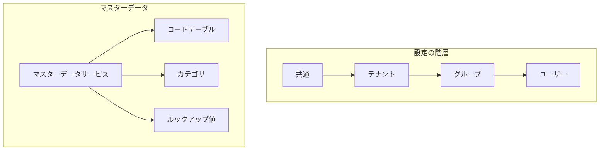

# マスターモジュール


マスターサービスは、マルチテナント環境でのマスターデータと設定の管理機能を提供します。
## 概要 {#overview}

マスターサービスは2つの主要コンポーネントで構成されています。


### マスター設定サービス
- 階層的な設定管理を実装
- すべてのレベルでの設定作成をサポート
- テナント設定の更新および削除操作を提供
- 階層的な設定取得を実装


### マスターデータサービス
- マスターデータエンティティのCRUD操作を実装
- リストおよび取得機能を提供
- コード検証機能を含む
- テナント間のデータ整合性を確保

## アーキテクチャ {#architecture}



## 設定階層レベル {#settings-hierarchy}

マスター設定サービスは4段階の階層を実装しています。設定は最も具体的なレベルから最も一般的なレベルに向かってカスケードします — `getSetting` は最初に見つかった設定を返します：

| レベル | スコープ | 作成メソッド | ユースケース |
|-----------|-----------|-----------------|-------------|
| **共通** | システム全体のデフォルト | `createCommonTenantSetting` | すべてのテナントで共有されるベースライン値 |
| **テナント** | 単一テナント | `createTenantSetting` | 共通デフォルトのテナント固有の上書き |
| **グループ** | テナントグループ | `createGroupSetting` | テナント内のグループレベルの上書き |
| **ユーザー** | 個別ユーザー | `createUserSetting` | テナント内の個人設定 |

`getSetting` は設定コードを **ユーザー → グループ → テナント → 共通** の順で解決します。どのレベルにも設定が存在しない場合、`NotFoundException` がスローされます。

## インストール {#installation}

```bash
npm install @mbc-cqrs-serverless/master
```

## 基本的な使い方 {#basic-usage}

`MasterModule` の動作をカスタマイズするには、静的な `register()` メソッドでオプションの `object` を渡します。

### モジュールオプション {#module-options}

| オプション | 型 | 説明 |
|--------|------|-------------|
| `enableController` | `boolean` | デフォルトのマスターコントローラーを有効または無効にする |
| `dataSyncHandlers` | `Type<IDataSyncHandler>[]` | マスターデータを外部システム（例：RDS）に同期するオプションハンドラー |
| `prismaService` | `Type<any>` | RDSバッククエリ用のPrismaサービス。`enableController: true` の場合は必須 |
| `tableName` | `string` | DynamoDB のベーステーブル名（デフォルト: `master`） |
| `commonTenantCode` | `string` | 共通マスターデータを保持するテナント（デフォルト: `common`） |
| `controllerAuth` | `{ read?: string[]; write?: string[] }` | 組み込みルートに対するオプトインのガード。[コントローラー認可](#controller-auth)を参照 |
| `enableCopyTask` | `boolean` | マスターコピーハンドラーを登録（デフォルト: `enableController` の値） |
| `databaseProvider` | `'postgresql' \| 'mysql'` | Prisma クライアントが接続するデータベース（デフォルト: Prisma クライアントから検出）。[データベースプロバイダー](#database-provider)を参照 |

:::warning prismaServiceの要件
`enableController: true` の場合、`prismaService` パラメータは **必須** です。コントローラーが有効な状態で `prismaService` が提供されていない場合、起動時にエラーがスローされます。
:::

```ts
import { MasterModule } from '@mbc-cqrs-serverless/master'

@Module({
  imports: [ MasterModule.register({
      enableController: true,
      dataSyncHandlers: [MasterDataRdsSyncHandler],
      prismaService: PrismaService,
      controllerAuth: {}, // Require a login for reads and system_admin for writes (読み取りにはログイン、書き込みには system_admin を必須にする)
    })],
  controllers: [],
  exports: [],
})

```

## キーのルール {#key-rules}

マスターのキーはリクエスト内のコードから組み立てられます。設定は `MASTER_SETTING#<code>`、データ行は `<settingCode>#<code>`、グループ設定とユーザー設定は `MASTER_SETTING#GROUP#<groupId>#<code>` と `MASTER_SETTING#USER#<userId>#<code>` に保存されます。これらの値はそれぞれ単一のキーセグメントでなければなりません:

- 空であってはなりません。
- キーの区切り文字である `#` を含んではなりません。含むと、その値が別の行のキーを組み立ててしまいます。たとえば設定コード `USER#u1#S1` はユーザーの個人設定になります。
- ソートキーのバージョン区切り文字である `@` を含んではなりません。
- 設定コードおよびマスターデータの `settingCode` は `MASTER_SETTING` であってはなりません。

ルールに違反するリクエストは 400 で失敗します。このルールは、すべての設定の作成と upsert（共通、テナント、グループ、ユーザー、一括）、マスターデータの作成・upsert・2 つの一括エンドポイント、`getSetting`（`GET /api/master-setting/:code`）、`MasterDataService.list`（`GET /api/master-data`）に適用されます。一括リクエストは、最初の書き込みの前にすべての項目のキーを検証します。

行はそれぞれ専用のルートからのみ変更されます。`PATCH`/`DELETE /api/master-setting/:pk/:sk`（`updateSetting`/`deleteSetting`）は設定キー（`MASTER_SETTING#<code>` とグループ・ユーザーのキー）のみを受け付け、`PUT`/`DELETE /api/master-data/:pk/:sk`（`update`/`delete`）は `MASTER_SETTING#...` キーを拒否します。どちらも `@` を含むソートキーを拒否します。

:::warning 既知の問題（v1.8.0で修正）
v1.8.0 より前のバージョンでは、コードが検証されていませんでした。core はソートキーを最後の `@` で切り詰めていたため、`@` を 1 つ含む値（`userId` やコードとして使われたメールアドレスなど）は、切り詰められた別のキーに黙って保存され、`@` を 2 つ以上含むコード（例: `X@Y@Z`）では、キーに `@` が残った行（`MASTER_SETTING#X@Y`）が保存される可能性がありました。v1.8.0 以降、このような行は API から読み取り・更新・削除できなくなります。該当行（DynamoDB のデータテーブルまたは RDS のマスターテーブルで `@` を含むソートキー）を探し、有効なキーで作り直してください。`code` に `#` を含む状態で既に保存されているマスターデータ行は、引き続き読み取ることができ、キー指定で更新・削除できます。

参照： [マイグレーションガイド v1.8.0](/docs/migration/v1.8.0#key-segments)
:::

## コントローラー認可 {#controller-auth}

組み込みのマスタールートを保護するには `controllerAuth` を設定します。空のオブジェクトであっても設定すると、`MasterDataController`、`MasterSettingController`、`MasterBulkController`、`MasterAccessController` およびタスクコントローラー（`/api/tasks`）で `MasterControllerGuard` が有効になります。

```ts
MasterModule.register({
  enableController: true,
  controllerAuth: { read: [], write: ['master_editor'] },
  dataSyncHandlers: [MasterDataSyncRdsHandler],
  prismaService: PrismaService,
})
```

- `sub` クレームのないリクエストは拒否されます。
- `read` が空または省略の場合は、ログイン済みの任意のユーザーを意味します。`write` が空または省略の場合は `system_admin` のみになります。`system_admin` は常に通過し、グループから解決されたロールも考慮されます。
- `GET` ルートと 2 つの `POST .../check-exist` ルートは読み取りです。それ以外のルートはすべて書き込みです。
- リクエストで指定されたテナント（パスのキー、ボディまたはクエリの `tenantCode`、コピー元とコピー先）は呼び出し元のテナントでなければなりません。ただし、共通テナントの読み取りのみの場合、または呼び出し元がクロステナントロールを持つ場合を除きます。それ以外の場合、ガードは 400 `Invalid tenant code` を返します。
- `POST /api/master-setting/copy` は `write` の設定にかかわらず `system_admin` を必要とします（[マスターコピーのアクセス](#master-copy-access)を参照）。
- `controllerAuth` がない場合、ルートは保護されないままで、コントローラーが有効なときは `MasterModule` が起動時に警告をログ出力します。

:::info バージョンノート
`controllerAuth`、`commonTenantCode`、`enableCopyTask`、`databaseProvider`、`systemId`、`@MasterAccessResolver()`、`GET /api/master-access`、`assignSystem`、`includeCommon` は[バージョン 1.8.0](/docs/changelog#v180) で追加されました。v1.8.0 以降の `mbc new` で作成したプロジェクトには空の `controllerAuth` オブジェクトが含まれるため、ロールを設定するまでマスターの書き込みには `system_admin` が必要です。
:::

:::caution ヘッダーで選択した共通テナント
トークンに `custom:tenant` クレームがなく、`x-tenant-code` で共通テナントを指定した呼び出し元は、`commonTenantCode` が環境変数 `COMMON_TENANT_CODES` に含まれていない場合に 403 を受け取る可能性があります。ベースの `RolesGuard` のテナント上書きチェックは、モジュールオプションではなくこの環境変数を参照するためです。`commonTenantCode` を変更する場合は、同じ値を `COMMON_TENANT_CODES` にも追加してください。
:::

## システム単位のアクセス制御 {#access-control}

複数のプロダクトが、1 つの中央サービスで管理されるマスターデータを共有できます。各マスター設定は、その設定とデータがどのプロダクト向けかを示す `systemId` を持つことができ、オプションのアクセスリゾルバーがシステム単位・設定単位で読み取りと書き込みを許可します。リゾルバーがない場合、`systemId` は無視され、サービスは従来どおりに動作します。

全体の設計、導入順序、システム単位の SNS への変更通知については、フレームワークのガイド [Master data access control and per-system sync](https://github.com/mbc-net/mbc-cqrs-serverless/blob/main/docs/development/master-access-and-sync.md) を参照してください。

### システム ID {#system-id}

- `systemId` はキーの外側の `attributes.__systemId`（定数 `MASTER_SYSTEM_ATTRIBUTE`、読み取り関数 `getSystemId(row)`）に保存されるため、各設定コードはテナント内で 1 つのオーナーを持ちます。API レスポンスではトップレベルの `systemId` として返され、`attributes` からは `__systemId` が隠されます。
- クライアントが `attributes` で送信した `__systemId` は、リゾルバーの有無にかかわらず常に削除されます。
- `shared` は、すべてのシステムが受け取るデータ用に予約されています。`systemId` のない行は `shared` として扱われます。
- 新しい設定は、`CommonSettingDto`、`TenantSettingDto` または一括の設定項目で `systemId` を指定できます。テナント→共通の順の検索で見える設定と同じコードを持つ設定は、その `systemId` を継承し、矛盾する明示的な値は 400 になります。`systemId` を持たない共通設定に対するテナントレベルの上書きは `shared` として扱われます。
- データ行はクライアントから `systemId` を受け付けません。有効な設定（テナントの設定、次に共通テナントの設定）の値を引き継ぎます。
- `systemId` は小文字で保存され、`*` にはできず、一度設定すると変更できません。
- グループ設定とユーザー設定は `systemId` を保存しません。アクセスはベースとなる設定に従います。

### リゾルバーの作成 {#access-resolver}

`@MasterAccessResolver()` でクラスを 1 つだけ登録します。このデコレーターは `@Injectable()` を適用するため、自分で追加しないでください。クラスは `MasterModule` と一緒に読み込まれるモジュールの providers に追加します。リゾルバーが 2 つ以上あると起動時にエラーになります。

```ts
import {
  IMasterAccessResolver,
  MasterAccessGrant,
  MasterAccessResolver,
  ResolveMasterAccessInput,
} from '@mbc-cqrs-serverless/master'

@MasterAccessResolver()
export class AppMasterAccessResolver implements IMasterAccessResolver {
  async resolveGrants(
    input: ResolveMasterAccessInput, // userId, tenantCode, roles, claims (ユーザーID、テナントコード、ロール、クレーム)
  ): Promise<MasterAccessGrant[]> {
    if (!input.userId) return []
    if (input.roles.includes('system_admin')) {
      return [{ systemId: '*', settingCode: '*', read: true, write: true }]
    }
    const grants: MasterAccessGrant[] = [
      // Everyone may read shared data (全員が共有データを読み取り可能)
      { systemId: 'shared', settingCode: '*', read: true, write: false },
    ]
    if (input.roles.includes('app_a_editor')) {
      grants.push({ systemId: 'app-a', settingCode: '*', read: true, write: true })
    }
    return grants
  }
}
```

- グラントは `systemId`（または `*`）、`settingCode`（または `*`）、`read`、`write` を持ちます。書き込みは読み取りを含みます。
- リゾルバーが登録されている場合、アクセスはデフォルトで拒否され、グラントは和集合として扱われます。リゾルバーが例外をスローすると、リクエストは失敗します。
- `system_admin` 用の組み込みのバイパスはありません。通常は `*` のグラントを返すことで、リゾルバーが判断します。
- グラントはリクエストイベントごとに 1 回解決されます。

### サービスがチェックする内容 {#service-checks}

`MasterSettingService` と `MasterDataService` は自らアクセスを強制するため、独自のルートもチェックされます。各メソッドは `invokeContext` と次のオプションフィールドを持つオプションオブジェクトを受け取ります:

```ts
interface MasterAccessOptions {
  invokeContext?: IInvoke
  scope?: { tenantCode?: string; systemId?: string } // Narrows only (絞り込みのみ)
  skipAccessCheck?: boolean // Trusted internal work (信頼された内部処理)
  systemId?: string // Internal callers only, used by copy (内部呼び出し専用、コピーで使用)
}
```

リゾルバーが登録されている場合:

1. `skipAccessCheck: true` は通過します。
2. `invokeContext` のない呼び出しは、読み取りを含め 403 で拒否されます。サーバー側のコードは `invokeContext` を渡すか、信頼された内部処理では `skipAccessCheck: true` を指定する必要があります。
3. レコードのテナントは、呼び出し元のテナントであるか、読み取りの場合は共通テナントであるか、呼び出し元がクロステナントロールを持っている必要があります。
4. ログインしていない呼び出し元は書き込みできず、読み取りには `scope.tenantCode` が必要です。
5. グラントは、レコードの `systemId`（または `shared`）と設定コードをカバーしている必要があります。

一覧エンドポイントはグラントを Prisma の `where` に追加するため、ページネーションと `total` は正しく保たれます。グラントがない場合は空の一覧になります。検索の `systemId` は結果を絞り込むだけです。`checkExistCode` はテナントのみをチェックするため、フォームはユーザーが見ることのできないシステムが所有するコードについても警告できます。

### アクセスエンドポイント {#master-access-endpoint}

`GET /api/master-access` は `enabled` と `grants` を返すため、UI で操作の表示・非表示を切り替えられます。リゾルバーがない場合、`enabled` は false で `grants` は空です。ログインしていない呼び出し元の場合、`enabled` は true、`grants` は空で、リゾルバーは呼び出されません。独自のルートを持つアプリケーションは、`invokeContext` を指定して `MasterAccessService.getAccess` を呼び出せます。

### 既存データのタグ付け {#assign-system}

`MasterSettingService.assignSystem` は、設定コードのタグ付けされていない既存の行に所有システムを設定します:

```ts
const { updated } = await this.masterSettingService.assignSystem(
  { code: 'APP_A_ROUTE_TYPE', systemId: 'app-a', tenantCode: 'acme' },
  { invokeContext },
)
```

- リゾルバーと、対象システムおよび `shared` への書き込みアクセスが必要です。`tenantCode` を指定しない場合はすべてのテナントが対象となり、クロステナントロールが必要です。
- RDS から候補の行（`system_id` が `NULL`）を検索し、最新のコマンドが既に `systemId` を持つ行はスキップして、発行した行数を返します。グループ設定とユーザー設定は変更されません。
- 組み込みのルートを持たない移行ツールです。コンシューマーがサブスクライブする前に実行し、Lambda のタイムアウト内に収まるようテナント単位で処理を分割してください。

### 共通テナントの行を含める {#include-common}

`MasterSettingService.list`（`GET /api/master-setting/list`）または `MasterDataService.listByRds`（`GET /api/master-data/list`）の検索で `includeCommon: true` を渡すと、呼び出し元のテナントが持たないコードの共通テナントの行が追加されます。デフォルトはオフで、リゾルバーの有無にかかわらず動作します。

- `includeCommon` を指定したマスターデータの一覧では、呼び出し元が共通テナントに属する場合を除き `settingCode` が必要です。
- テナントが保持できる一致行は、論理削除された行を含めて最大 10,000 件で、それを超えると 400 になります。結果が切り捨てられることはありません。
- `includeCommon` を指定した設定の一覧では、共通テナントのグループ設定とユーザー設定の行はマージされません。

### RDS の system_id カラム {#rds-system-id}

一覧のアクセスフィルターは RDS マスターテーブルの `system_id` カラムを参照します。NULL 許容のカラムを追加し、RDS ハンドラーで書き込みます:

```prisma
systemId String? @map("system_id")
@@index([tenantCode, systemId])
```

```ts
update: { /* ... */ systemId: getSystemId(cmd) },
create: { /* ... */ systemId: getSystemId(cmd) },
```

新規プロジェクトはテンプレートから両方を取得します。以前に生成したプロジェクトは手動で追加する必要があります。`update-scheme.ts` は既存のスキーマやハンドラーを変更しないためです。このカラムはリゾルバーを使う場合にのみ必要です。カラムを追加し、ハンドラーを更新してデプロイしてから、リゾルバーを登録してください。リゾルバーが登録されていて Prisma の `Master` モデルに `systemId` フィールドがない場合、アプリケーションは起動を拒否します。

### マスターコピーのアクセス {#master-copy-access}

- `controllerAuth` がある場合、`POST /api/master-setting/copy` は `controllerAuth.write` の設定にかかわらず `system_admin` を必要とします。
- リゾルバーがある場合、`MasterSettingService.copy` は `system_admin` と、`systemId` と `settingCode` がどちらも `*` の書き込みグラントを必要とします。
- コピーでは、`system_admin` は `custom:roles` クレームから得られたものでなければならず、グループから解決されたロールは考慮されません。別のテナントへのコピーは、`system_admin` がクロステナントロール（`CROSS_TENANT_ROLES`、デフォルト `system_admin`）であることを前提とします。
- バックグラウンドのコピー処理は `skipAccessCheck` で実行されるため、ユーザーのクレームがなくても動作します。`enableCopyTask` がこれを登録し、デフォルトは `enableController` の値です。

## データベースプロバイダー {#database-provider}

master パッケージと survey template パッケージは、PostgreSQL または MySQL 用の Prisma 検索フィルターを組み立てます。デフォルトではプロバイダーは Prisma クライアントから検出され、検出できない場合は起動時に警告を出して PostgreSQL にフォールバックします。明示的に選択するには `databaseProvider` を設定します:

```ts
MasterModule.register({
  enableController: true,
  prismaService: PrismaService,
  databaseProvider: 'mysql', // or 'postgresql' (または 'postgresql')
})
```

PostgreSQL では部分一致検索に `mode: 'insensitive'` を使用し、MySQL ではデフォルトの大文字小文字を区別しない照合順序に依存します。`registerAsync` を使う場合は、`databaseProvider`、`commonTenantCode`、`controllerAuth` を静的に渡してください。静的な値はファクトリーが返す値を上書きします。

:::warning 既知の問題（v1.8.0で修正）
v1.8.0 より前のバージョンでは、MySQL（`mbc new` のデフォルトデータベース）で名前・コード・キーワード検索が失敗していました。PostgreSQL 専用の `mode: 'insensitive'` を常に送信していたためです。回避策として dist ファイルにパッチを当てている場合は、アップグレード後にパッチを削除してください。

参照： [変更履歴 v1.8.0](/docs/changelog#v180)
:::

## APIリファレンス {#api-reference}

### マスター設定サービス
MasterSettingService インターフェースは、ユーザー、グループ、テナント、共通のさまざまなレベルで設定を管理します。設定の取得、更新、作成、削除を可能にします。

#### `getSetting(dto: GetSettingDto, context: { invokeContext: IInvoke }): Promise<MasterSettingEntity>`
指定された設定コードに基づいて特定の設定を取得します。
```ts
const masterSetting = await this.masterSettingService.getSetting(
  {
    code: "service",
  },
  { invokeContext }
);
```

#### `createCommonTenantSetting(dto: CommonSettingDto, context: { invokeContext: IInvoke }): Promise<CommandModel>`
システム全体で共有される共通のテナント設定を作成します。
```ts
const masterSetting = await this.masterSettingService.createCommonTenantSetting(
  {
    name: "common setting",
    code: "service",
    settingValue: {
      region: "US",
      plan: "common"
    }
  },
  { invokeContext }
);
```

#### `createTenantSetting(dto: TenantSettingDto, context: { invokeContext: IInvoke }): Promise<CommandModel>`
テナント固有の設定を作成します。
```ts
const masterSetting = await this.masterSettingService.createTenantSetting(
  {
    name: "tenant setting",
    code: "service",
    tenantCode: "mbc",
    settingValue: {
      region: "US",
      plan: "tenant"
    }
  },
  { invokeContext }
);
```

#### `createGroupSetting(dto: GroupSettingDto, context: { invokeContext: IInvoke }): Promise<CommandModel>`
テナント内でグループ固有の設定を作成します。
```ts
const masterSetting = await this.masterSettingService.createGroupSetting(
  {
    name: "group setting",
    code: "service",
    tenantCode: "mbc",
    groupId: "12",
    settingValue: {
      region: "US",
      plan: "USER"
    }
  },
  { invokeContext }
);
```
#### `createUserSetting(dto: UserSettingDto, context: { invokeContext: IInvoke }): Promise<CommandModel>`
テナント内でユーザー固有の設定を作成します。
```ts
const masterSetting = await this.masterSettingService.createUserSetting(
  {
    name: "user setting",
    code: "service",
    tenantCode: "mbc",
    userId: "92ca4f68-9ac6-4080-9ae2-2f02a86206a4",
    settingValue: {
      region: "US",
      plan: "USER"
    }
  },
  { invokeContext }
);
```


#### `updateSetting(key: DetailKey, dto: UpdateSettingDto, context: { invokeContext: IInvoke }): Promise<CommandModel>`
既存の設定を更新します。
```ts
const masterSetting = await this.masterSettingService.updateSetting(
  {
    pk: "MASTER#abc",
    sk: "MASTER_SETTING#service"
  },
  {
    name: 'Example Master Setting',
    settingValue: {
      homepage: "url",
      desc: "string"
    }
  },
  { invokeContext }
);
```

#### `deleteSetting(key: DetailKey, context: { invokeContext: IInvoke }): Promise<CommandModel>`
指定されたキーに基づいて特定の設定を削除します。
```ts
const masterSetting = await this.masterSettingService.deleteSetting(
  {
    pk: "MASTER#abc",
    sk: "MASTER_SETTING#service"
  },
  { invokeContext }
);
```

#### `list(searchDto: MasterSettingSearchDto, invokeContext: IInvoke): Promise<MasterRdsListEntity>`
ページネーションとフィルタリングでマスター設定をリストします。RDS（Prisma）の設定が必要です。
```ts
const result = await this.masterSettingService.list(
  {
    name: "service",           // Partial match for name (名前の部分一致)
    code: "SVC",               // Partial match for code (コードの部分一致)
    keyword: "description",    // Search in attributes.description (attributes.description内を検索)
    page: 1,
    pageSize: 10,
    orderBys: ["-createdAt"],
  },
  invokeContext
);
```

#### `getDetail(key: DetailDto): Promise<MasterRdsEntity>`
詳細なマスター設定を取得します。見つからない場合はNotFoundExceptionをスローします。
```ts
const masterSetting = await this.masterSettingService.getDetail({
  pk: "MASTER#mbc",
  sk: "MASTER_SETTING#service"
});
```

#### `create(createDto: CommonSettingDto, invokeContext: IInvoke): Promise<CommandModel>`
新しいテナント設定を作成します。コンテキストからテナントコードを自動抽出するcreateTenantSettingのラッパーです。
```ts
const masterSetting = await this.masterSettingService.create(
  {
    code: "service",
    name: "Service Setting",
    settingValue: { key: "value" }
  },
  invokeContext
);
```

#### `createBulk(createDto: CommonSettingBulkDto, invokeContext: IInvoke): Promise<CommandModel[]>`
複数の設定を一度に作成します。

:::warning 新規作成のみの操作
`createBulk`は内部的に各アイテムに対して`create`を呼び出します。設定が既に存在する場合（例: `"Setting already exists: {code}"`）、`BadRequestException`をスローします。このメソッドは既存の設定の更新には使用できません。upsert動作（作成または更新）が必要な場合は、以下の[Upsertパターン](#upsert-pattern)セクションを参照してください。
:::

```ts
const settings = await this.masterSettingService.createBulk(
  {
    items: [
      { code: "setting1", name: "Setting 1", settingValue: {} },
      { code: "setting2", name: "Setting 2", settingValue: {} }
    ]
  },
  invokeContext
);
```

#### `update(key: DetailDto, updateDto: MasterSettingUpdateDto, invokeContext: IInvoke): Promise<CommandModel | null>`
マスター設定を更新します。
```ts
const result = await this.masterSettingService.update(
  { pk: "MASTER#mbc", sk: "MASTER_SETTING#service" },
  {
    name: "Updated Setting",
    attributes: { newKey: "newValue" }
  },
  invokeContext
);
```

#### `delete(key: DetailDto, invokeContext: IInvoke): Promise<CommandModel | null>`
マスター設定を削除します。deleteSettingのラッパーです。
```ts
await this.masterSettingService.delete(
  { pk: "MASTER#mbc", sk: "MASTER_SETTING#service" },
  invokeContext
);
```

#### `checkExistCode(code: string, invokeContext: IInvoke): Promise<boolean>`
現在のテナントに設定コードが既に存在するかどうかを確認します。
```ts
const exists = await this.masterSettingService.checkExistCode("service", invokeContext);
if (exists) {
  // Handle duplicate code (重複コードの処理)
}
```

#### `copy(masterCopyDto: MasterCopyDto, opts: { invokeContext: IInvoke }): Promise<any>`
Step Functionsを使用して、マスター設定とデータを他のテナントに非同期でコピーします。既存のマスターデータで新しいテナントを初期化するのに便利です。
```ts
const task = await this.masterSettingService.copy(
  {
    masterSettingId: "MASTER#mbc#MASTER_SETTING#service",
    targetTenants: ["tenant1", "tenant2"],
    copyType: CopyType.BOTH,   // CopyType.SETTING_ONLY, CopyType.DATA_ONLY, or CopyType.BOTH (CopyType.SETTING_ONLY、CopyType.DATA_ONLY、またはCopyType.BOTH)
    dataCopyOption: {
      mode: DataCopyMode.ALL,  // or DataCopyMode.PARTIAL (またはDataCopyMode.PARTIAL)
      // id: ["id1", "id2"]    // Required when mode is PARTIAL (modeがPARTIALの場合は必須)
    }
  },
  { invokeContext }
);
// Returns a task entity - the copy operation runs asynchronously (タスクエンティティを返します - コピー操作は非同期で実行されます)
```

コピータイプ:
- `CopyType.SETTING_ONLY`: 設定のみをコピー
- `CopyType.DATA_ONLY`: データのみをコピー
- `CopyType.BOTH`: 設定とデータの両方をコピー

データコピーモード（copyTypeがDATA_ONLYまたはBOTHの場合に使用）:
- `DataCopyMode.ALL`: 設定下のすべてのマスターデータをコピー
- `DataCopyMode.PARTIAL`: 指定されたIDのみをコピー

`controllerAuth` またはアクセスリゾルバーを使う場合、コピーには `system_admin` が必要です（[マスターコピーのアクセス](#master-copy-access)を参照）。

:::warning 既知の問題（v1.8.0で修正）
v1.8.0 より前のバージョンでは、マスターコピーはコピー元の設定のテナントではなくハードコードされた `meltec` テナントからデータを読み取り、両方のキーがコピー先のテナントから組み立てられていたためシーケンスをコピーしていませんでした。v1.8.0 以降、コピーはコピー元のテナントを読み取り、シーケンスもコピーします。コピー元より遅れているコピー先のシーケンスはコピー元の値まで進み、その間に番号を発行したコピー先が巻き戻されることはありません。

参照： [変更履歴 v1.8.0](/docs/changelog#v180)
:::

### マスターデータサービス
MasterDataService サービスは、マスターデータと操作を管理するためのメソッドを提供します。これには、リスト、取得、作成、更新、削除、および特定のコードの存在確認が含まれます。

#### `list(searchDto: MasterDataSearchDto): Promise<MasterDataListEntity>`
指定した検索条件に基づいてマスターデータを一覧表示します。アクセスリゾルバーがない場合、このメソッドに invoke context は不要です。リゾルバーが登録されている場合は、第 2 引数に `invokeContext`（または `skipAccessCheck: true`）を渡します。呼び出し元が読み取れない行は除外されます（[サービスがチェックする内容](#service-checks)を参照）。
```ts
const masterData = await this.masterDataService.list({
  tenantCode: "mbc",
  settingCode: "service"
});
```

#### `get(key: DetailDto): Promise<MasterDataEntity>`
主キー (pk) およびソートキー (sk) によるマスターデータの取得。

```ts
const masterData = await this.masterDataService.get(
  {
    pk:"MASTER#abc", 
    sk:"service#01"
  }
);
```

  
#### `create(data: CreateMasterDataDto, context: { invokeContext: IInvoke }): Promise<MasterDataEntity>`

新しいマスターデータエンティティを作成します。

```ts
const masterData = await this.masterDataService.create(
  {
    code: 'MASTER001',
    name: 'Example Master Data',
    settingCode: "service",
    tenantCode: "common",
    attributes: {
      homepage: "http://mbc.com",
      desc: "description for mbc"
    }
  },
  { invokeContext }
);
```

#### `update(key: DetailDto, updateDto: UpdateDataSettingDto, context: { invokeContext: IInvoke }): Promise<MasterDataEntity>`
既存のマスターデータを更新します。

```ts
const masterData = await this.masterDataService.update(
  {
    pk: "MASTER#abc",
    sk: "service#01"
  },
  {
    name: 'Example Master Data',
    attributes: {
      homepage: "http://mbc.com",
      desc: "description for mbc"
    }
  },
  { invokeContext }
);
```


#### `delete(key: DetailDto, opts: { invokeContext: IInvoke }): Promise<MasterDataEntity>`
指定されたキーに基づいて特定のマスターデータを削除します。
```ts
const masterData = await this.masterDataService.delete(
  {
    pk: "MASTER#abc",
    sk: "service#01"
  },
  { invokeContext }
);
```

#### `checkExistCode(tenantCode: string, type: string, code: string): Promise<boolean>`
指定されたテナントとタイプ内で特定のコードが存在するかどうかを確認します。

```ts
const exists = await this.masterDataService.checkExistCode("mbc", "service", "01");
if (exists) {
  // Handle existing code (既存コードの処理)
}
```

#### `getDetail(key: DetailDto): Promise<MasterRdsEntity>`
関連情報を含む詳細なマスターデータを取得します。見つからない場合はNotFoundExceptionをスローします。

```ts
const masterData = await this.masterDataService.getDetail({
  pk: "MASTER#mbc",
  sk: "service#01"
});
```

#### `createSetting(createDto: MasterDataCreateDto, invokeContext: IInvoke): Promise<MasterDataEntity>`
新しいマスターデータエンティティを作成します。シーケンスが指定されていない場合は自動生成されます。

:::warning 新規作成のみの操作
`createSetting`はマスターデータが既に存在する場合（例: `"Master data already exists"`）、`BadRequestException`をスローします。upsert動作（作成または更新）が必要な場合は、以下の[Upsertパターン](#upsert-pattern)セクションを参照してください。
:::

```ts
const masterData = await this.masterDataService.createSetting(
  {
    code: 'MASTER001',
    name: 'Example Master Data',
    settingCode: "service",
    tenantCode: "mbc",
    attributes: {
      homepage: "http://mbc.com",
      desc: "description for mbc"
    }
  },
  invokeContext
);
```

#### `createBulk(createDto: MasterDataCreateBulkDto, invokeContext: IInvoke): Promise<MasterDataEntity[]>`
複数のマスターデータエンティティを一括作成します。

:::warning 新規作成のみの操作
`createBulk`は内部的に各アイテムに対して`createSetting`を呼び出します。既に存在するアイテムがある場合、`BadRequestException`をスローします。upsert動作が必要な場合は、以下の[Upsertパターン](#upsert-pattern)セクションを参照してください。
:::

```ts
const masterDataList = await this.masterDataService.createBulk(
  {
    items: [
      {
        code: 'MASTER001',
        name: 'First Master Data',
        settingCode: "service",
        tenantCode: "mbc",
        attributes: {}
      },
      {
        code: 'MASTER002',
        name: 'Second Master Data',
        settingCode: "service",
        tenantCode: "mbc",
        attributes: {}
      }
    ]
  },
  invokeContext
);
```

#### `updateSetting(key: DetailDto, updateDto: MasterDataUpdateDto, invokeContext: IInvoke): Promise<MasterDataEntity>`
既存のマスターデータエンティティを更新します。

```ts
const masterData = await this.masterDataService.updateSetting(
  {
    pk: "MASTER#mbc",
    sk: "service#01"
  },
  {
    name: 'Updated Master Data',
    attributes: {
      homepage: "http://updated-mbc.com"
    }
  },
  invokeContext
);
```

#### `deleteSetting(key: DetailDto, invokeContext: IInvoke): Promise<MasterDataEntity>`
キーでマスターデータエンティティを削除します。

```ts
const result = await this.masterDataService.deleteSetting(
  {
    pk: "MASTER#mbc",
    sk: "service#01"
  },
  invokeContext
);
```

#### `listByRds(searchDto: CustomMasterDataSearchDto, context: { invokeContext: IInvoke }): Promise<MasterRdsListEntity>`
フィルタリングとページネーションでRDS内のマスターデータを検索します。このメソッドはPrismaサービスが設定されている場合に使用されます。

```ts
const result = await this.masterDataService.listByRds(
  {
    settingCode: "service",    // Exact match for master type code (マスタータイプコードの完全一致)
    keyword: "example",        // Partial match (case-insensitive) for name (名前の部分一致（大文字小文字を区別しない）)
    code: "001",               // Partial match (case-insensitive) for master code (マスターコードの部分一致（大文字小文字を区別しない）)
    page: 1,
    pageSize: 10,
    orderBys: ["seq", "masterCode"],
  },
  { invokeContext }
);
```

##### 検索パラメータ {#search-parameters}

| パラメータ | 型 | 必須 | マッチタイプ | 説明 |
|---------------|----------|--------------|----------------|-----------------|
| `settingCode` | `string` | いいえ | 完全一致 | マスタータイプコード（masterTypeCode）でフィルタ |
| `keyword` | `string` | いいえ | 部分一致（大文字小文字を区別しない） | 名前フィールドでフィルタ |
| `code` | `string` | いいえ | 部分一致（大文字小文字を区別しない） | マスターコードでフィルタ |
| `page` | `number` | いいえ | - | ページ番号（デフォルト: 1） |
| `pageSize` | `number` | いいえ | - | 1ページあたりの項目数（デフォルト: 10） |
| `orderBys` | `string[]` | いいえ | - | ソート順（デフォルト: ["seq", "masterCode"]） |
| `isDeleted` | `boolean` | いいえ | 完全一致 | 削除ステータスでフィルタ |
| `systemId` | `string` | いいえ | 完全一致（大文字小文字を区別しない） | 結果を 1 つのシステムに絞り込みます。アクセスリゾルバーを使う場合のみ使用されます |
| `includeCommon` | `boolean` | いいえ | - | テナントが持たないコードの共通テナントの行を追加します（[共通テナントの行を含める](#include-common)を参照） |

:::warning 既知の問題（v1.0.17で修正済み）
v1.0.17より前のバージョンでは、`settingCode` パラメータが誤って完全一致ではなく部分一致（`contains`）を使用していました。これにより意図しない検索結果が返される問題がありました。例えば、「PRODUCT」を検索すると「PRODUCT_TYPE」や「MY_PRODUCT」も返されていました。

v1.0.16以前をご使用で、`settingCode` の完全一致が必要な場合は、v1.0.17以降にアップグレードしてください。

参照： [変更履歴 v1.0.17](/docs/changelog#v1017)
:::

## ビルトインUpsert API {#upsert-pattern}

フレームワークは、新規レコードの作成と既存レコードの更新の両方を自動的に処理するビルトインupsertメソッドを提供します。これらのメソッドはDynamoDBで既存データを確認し、作成または更新を判断し、変更のないレコードはスキップして効率化します。

:::info バージョンノート
ビルトインupsertメソッド（`upsert`、`upsertBulk`、`upsertSetting`、`upsertTenantSetting`）は[バージョン1.1.2](/docs/changelog#v112)で追加されました。それ以前のバージョンでは、カスタムupsertロジックの実装が必要です（下記の[レガシーUpsertパターン](#legacy-upsert-pattern)を参照）。
:::

### MasterSettingService Upsertメソッド

#### `upsertTenantSetting(dto: TenantSettingDto, options: { invokeContext: IInvoke }): Promise<CommandModel>`
テナント設定を作成または更新します。設定が存在し変更がある場合は更新します。設定が存在するが変更がない場合は、新しいコマンドを作成せずに既存のデータを返します。設定が削除されている場合は再作成します。

```ts
const result = await this.masterSettingService.upsertTenantSetting(
  {
    tenantCode: "mbc",
    code: "service",
    name: "Service Setting",
    settingValue: { region: "US", plan: "Premium" },
  },
  { invokeContext }
);
```

#### `upsertSetting(createDto: CommonSettingDto, invokeContext: IInvoke): Promise<CommandModel>`
コンテキストからテナントコードを自動抽出する`upsertTenantSetting`のラッパーです。

```ts
const result = await this.masterSettingService.upsertSetting(
  {
    code: "service",
    name: "Service Setting",
    settingValue: { region: "US", plan: "Premium" },
  },
  invokeContext
);
```

#### `upsertBulk(createDto: CommonSettingBulkDto, invokeContext: IInvoke): Promise<CommandModel[]>`
複数の設定を順次upsertします。レースコンディションを回避するため、アイテムは1つずつ処理されます。

```ts
const results = await this.masterSettingService.upsertBulk(
  {
    items: [
      { code: "setting1", name: "Setting 1", settingValue: { key: "value1" } },
      { code: "setting2", name: "Setting 2", settingValue: { key: "value2" } },
    ]
  },
  invokeContext
);
```

### MasterDataService Upsertメソッド

#### `upsert(createDto: CreateMasterDataDto, opts: { invokeContext: IInvoke }): Promise<MasterDataEntity>`
マスターデータエンティティを作成または更新します。`create`と同じ動作ですが、レコードが既に存在する場合にエラーをスローしません。

```ts
const result = await this.masterDataService.upsert(
  {
    code: 'MASTER001',
    name: 'Example Master Data',
    settingCode: "service",
    tenantCode: "mbc",
    attributes: { homepage: "http://mbc.com" },
  },
  { invokeContext }
);
```

#### `upsertSetting(createDto: MasterDataCreateDto, invokeContext: IInvoke): Promise<MasterDataEntity>`
自動シーケンス生成とテナントコード抽出を備えた`upsert`のラッパーです。

```ts
const result = await this.masterDataService.upsertSetting(
  {
    code: 'MASTER001',
    name: 'Example Master Data',
    settingCode: "service",
    attributes: { homepage: "http://mbc.com" },
  },
  invokeContext
);
```

#### `upsertBulk(createDto: MasterDataCreateBulkDto, invokeContext: IInvoke): Promise<MasterDataEntity[]>`
複数のマスターデータエンティティを順次upsertします。seqのレースコンディションを回避するため、アイテムは1つずつ処理されます。

```ts
const results = await this.masterDataService.upsertBulk(
  {
    items: [
      { code: 'DATA001', name: 'First Data', settingCode: "service", attributes: {} },
      { code: 'DATA002', name: 'Second Data', settingCode: "service", attributes: {} },
    ]
  },
  invokeContext
);
```

### 統合バルクUpsert API（MasterBulkController） {#unified-bulk-upsert}

コントローラーが有効（`enableController: true`）の場合、フレームワークは設定とデータの両方を1つのリクエストで処理できる統合`/api/master-bulk/`エンドポイントを提供します。アイテムは`settingCode`の有無に基づいてルーティングされます：

- **`settingCode`あり**: `MasterDataService.upsertBulk`にルーティング
- **`settingCode`なし**: `MasterSettingService.upsertBulk`にルーティング

```ts
// POST /api/master-bulk/
const requestBody = {
  items: [
    // This item has settingCode → treated as master data (settingCodeあり → マスターデータとして扱う)
    {
      name: "Data Item",
      code: "DATA001",
      settingCode: "UserList",
      seq: 1,
      attributes: { field: "value" },
    },
    // This item has no settingCode → treated as master setting (settingCodeなし → マスター設定として扱う)
    {
      name: "Setting Item",
      code: "SettingA",
      attributes: { description: "A setting" },
    },
  ]
};
```

レスポンスは元の入力順序を保持します。テナントコードバリデーションが適用されます：アイテムに`tenantCode`が指定されている場合、認証ユーザーのテナントと一致する必要があります。

このエンドポイントはまずすべての設定を upsert し、その後にデータ行を upsert するため、データ行は同じリクエストで作成された設定を使用できます。最初の書き込みの前に、すべての項目のキーが検証されます。

:::warning アトミックではありません
一括リクエストは設定とデータにまたがってアトミックではありません。アクセスリゾルバーが登録されている場合、データ項目のアクセスチェックは設定の書き込み後に実行されるため、禁止されたデータ項目があるとリクエストは 403 で失敗し、同じリクエストの設定は書き込まれたまま残ります。v1.8.0 以降は設定がデータより先に upsert されます。以前のバージョンでは両方を同時に upsert していました。
:::

#### リクエストボディ

| フィールド | 型 | 必須 | 説明 |
|-----------|----------|--------------|-----------------|
| `items` | `MasterBulkItemDto[]` | はい | upsertするアイテムの配列（最大100件） |

#### MasterBulkItemDto

| フィールド | 型 | 必須 | 説明 |
|-----------|----------|--------------|-----------------|
| `name` | `string` | はい | 設定またはデータの名前 |
| `code` | `string` | はい | 設定またはデータのコード |
| `tenantCode` | `string` | いいえ | テナントコード（指定する場合は認証ユーザーのテナントと一致する必要があります） |
| `settingCode` | `string` | いいえ | 存在する場合はマスターデータ、存在しない場合はマスター設定として扱われます |
| `seq` | `number` | いいえ | ソート順序（マスターデータで使用） |
| `systemId` | `string` | いいえ | 新しい設定の所有システム（設定のみ。アクセスリゾルバーを使う場合のみ使用） |
| `attributes` | `object` | はい | 属性オブジェクト。設定の場合、settingValueとして使用されます |

### Upsert動作の詳細 {#upsert-behavior}

upsertメソッドは以下のルールに従います：

1. **新規レコード**: 既存レコードが見つからない場合、新規作成します（バージョンは0から開始）
2. **変更のある既存レコード**: レコードが存在し入力が異なる場合、既存のバージョン番号を使用して更新します
3. **変更のない既存レコード**: レコードが存在し入力が同一の場合、更新をスキップして既存データを返します
4. **削除済みレコード**: レコードが存在するが削除マーク（`isDeleted: true`）の場合、既存のバージョン番号を使用して再作成します

### レガシーUpsertパターン {#legacy-upsert-pattern}

:::warning 非推奨パターン
以下のカスタム upsert パターンはバージョン1.1.2より前に必要でした。新規プロジェクトでは、代わりに[組み込みの upsert メソッド](#upsert-pattern)を使用してください。
:::

バージョン1.1.2より前では、既存レコードを確認してから create か update かを決定するカスタム upsert サービスを実装する必要がありました。完全なレガシーパターンは [v1.1.1 ドキュメント](https://github.com/mbc-net/mbc-cqrs-serverless/tree/v1.1.1)を参照してください。


## 関連ドキュメント

- [テナント](/docs/tenant) - テナント管理
- [設定](/docs/configuring) - シーケンスローテーション設定
- [サービスパターン](/docs/service-patterns) - マスターデータサービスパターン
- [マスターWeb](/docs/master-web) - フロントエンドのマスターデータ管理
- [マイグレーションガイド v1.8.0](/docs/migration/v1.8.0) - v1.8.0 のマスター関連の変更に関するアップグレードガイド
- [Master data access control and per-system sync（マスターデータのアクセス制御とシステム単位の同期）](https://github.com/mbc-net/mbc-cqrs-serverless/blob/main/docs/development/master-access-and-sync.md) - フレームワークガイド
